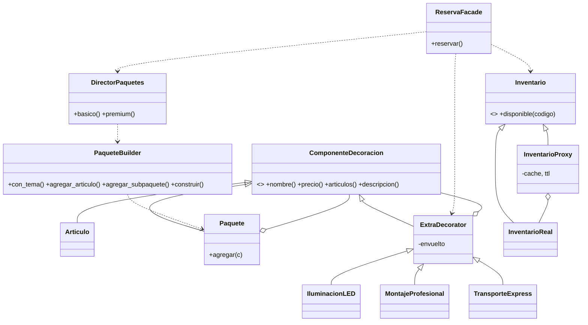

# Diseño

## Clases principales

## Flujo de `ReservaFacade.reservar()`
1. **Builder/Director** arma el paquete (**Composite**: mesas y sillas es un sub-paquete).
2. Por cada artículo del paquete se consulta el **Proxy**; si hay faltantes → `SinDisponibilidad`.
3. Se envuelven los extras con **Decorator**.
4. Se calcula total, anticipo (50 %) y se registra la bitácora.

## Decisiones
- Decorator y Composite comparten la interfaz `ComponenteDecoracion`, por eso un paquete decorado sigue siendo un componente válido.
- El proxy recibe el reloj por parámetro para poder probar la expiración sin esperas.
- Regla de mesas: 8 invitados por mesa, redondeando hacia arriba.
